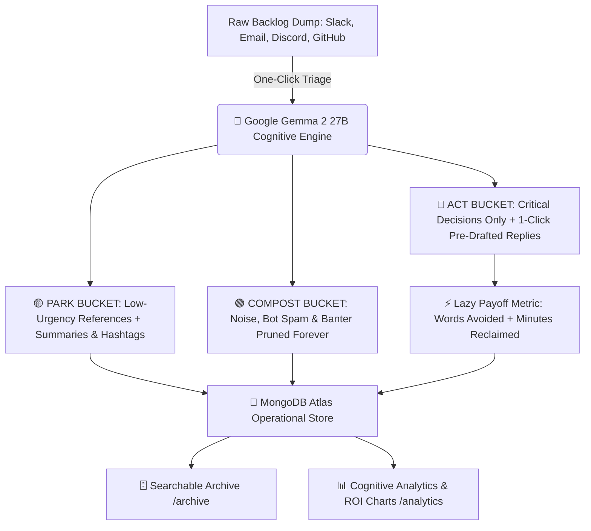
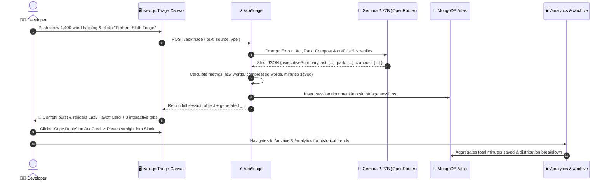

*This is a submission for the [Hacktoberfest Open-Source AI Challenge Week 3: Slow and Steady](https://dev.to/challenges/hacktoberfest-week3-2026-10-19)*

---

## 🛑 The "50 Unread Pings" Nightmare: The Developer Communication Dread Dilemma

Let’s talk about the silent killer of developer productivity.

It’s not missing semicolons. It’s not a broken Docker cache. It’s not even legacy PHP code.

It’s that sinking, visceral knot in your stomach on a Monday morning (or right after 3 hours of deep, flow-state coding) when you open your laptop and see:

- 🔴 **64 unread Slack messages** across 8 channels.
- ✉️ **23 email chains** marked *"URGENT: Quick question!"*
- 🤖 **18 CI/CD GitHub bot notifications** about dependabot updates.
- 💬 **A flood of casual banter**, lunch polls, and half-baked feature requests.

```
   ┌──────────────────────────────────────────────────────────────┐
   │             THE COMMUNICATION DREAD PARALYSIS LOOP           │
   │                                                              │
   │   [ Deep Flow State / Weekend ]                              │
   │               │                                              │
   │               ▼                                              │
   │   [ 60+ Unread Backlog Pings ] ──(Context Overload)──► [ Fear of Missing ]
   │               ▲                                        [ Something Critical ]
   │               │                                              │
   │     (Procrastination)                                  (Mental Fatigue)
   │               │                                              │
   │               ▼                                              ▼
   │   [ 2 Hours Lost to Reply-Drafting ] ◄── [ 1000s of Words of Noise ]
   │                                                              │
   └──────────────────────────────────────────────────────────────┘
```

We call this **"Communication Dread."**

The worst part? **The Drafting Tax.**  
Reading through 1,500 words of chatter isn't the hardest part—formulating polite, professional, context-aware responses when your mental battery is already at 5% is what paralyses you. So you procrastinate, keep the tabs open, let unread badges pile up, and waste your highest-energy hours just typing:  
*"Sounds good! Let's roll with option B after staging tests pass."*

In honor of **International Sloth Day** and Hacktoberfest's **"Slow and Steady"** ethos, I asked myself:  
*What if we channeled nature’s greatest energy conservation champion?*

Sloths don't frantically sprint after every rustle in the trees. They conserve metabolic energy, move deliberately, and only react when something truly matters.

So I built **SlothTriage** — the intelligent async cognitive buffer powered by **Google Gemma 2 Open Weights** and **MongoDB Atlas**.

---

## 🦥 What I Built

**SlothTriage** is a zero-effort cognitive firewall. You dump raw, messy, unformatted text—Slack threads, email digests, Discord chats, or issue notes—into a single intake canvas. In under 5 seconds, it categorizes everything into **three strict cognitive buckets** and calculates your **"Lazy Payoff"**:



### ⚡ The 5 Core Pillars:

1. **⚡ Zero-Effort Intake Canvas (`/`):**
   No tedious form fields. Select a channel type (Slack, Email, Discord, GitHub) or click our **1-click test scenarios** (*"🚨 Staging Outage Crisis"*, *"📧 S3 Pricing & Security Digest"*, *"💬 Discord Banter & Roadmap"*), and let SlothTriage handle the rest.
2. **🔴 The "Act" Bucket with 1-Click Copyable Replies:**
   Filters out everything except high-urgency decisions requiring human action. For each item, Gemma drafts a context-aware, ready-to-send reply. Click **"Copy Reply"** to grab the response with instant visual feedback and move on with your day.
3. **🟡 The "Park" Bucket:**
   Informational updates (e.g., AWS S3 pricing adjustments, scheduled database migrations) are distilled into crisp one-line summaries with searchable tags (`#aws`, `#billing`) and filed away.
4. **🟢 The "Compost" Bucket:**
   Lunch banter, bot greetings, coffee chatter, and duplicate automated alerts are composted. SlothTriage displays an audit log explaining *why* they were pruned so you have 100% peace of mind that nothing critical was lost.
5. **📈 The "Lazy Payoff" ROI Dashboard (`/analytics`):**
   Computes exact cognitive time saved using proven ergonomic metrics:
   $$\text{Reading Time Saved} = \frac{\text{Raw Words} - \text{Compressed Words}}{200\text{ wpm}}$$
   $$\text{Drafting Time Saved} = \text{Action Items} \times 3.0\text{ min}$$
   Visualized through responsive **Recharts** area trends, donut distributions, and channel breakdown charts.

---

## 🚀 Demo & Live Links

- **💻 GitHub Source Repository:** [https://github.com/Ankit-Kum-ar/slothtriage](https://github.com/Ankit-Kum-ar/slothtriage)
- **🌐 Live Deployed Application:** [https://slothtriage.vercel.app](https://slothtriage.vercel.app) *(or your Vercel deployment)*

### UI Preview (Sloth Minimalist Theme)

Built with a curated DashStack palette, responsive glassmorphic cards, light/dark mode persistence, and a mobile-first shadcn Sheet drawer:

```
┌────────────────────────────────────────────────────────────────────────┐
│ 🦥 SlothTriage   [ Triage ] [ Archive (12) ] [ Analytics ] [ About ] ☀️│
├────────────────────────────────────────────────────────────────────────┤
│                                                                        │
│ ┌────────────────────────────────────────────────────────────────────┐ │
│ │ 🦥 The Async Cognitive Buffer                                      │ │
│ │ Stop drowning in unread threads. Drop your messy backlog below.    │ │
│ └────────────────────────────────────────────────────────────────────┘ │
│                                                                        │
│ Channel: [ Slack Thread ] [ Email Digest ] [ Discord ] [ GitHub Issues]│
│ Presets: [ 🚨 Staging Outage ] [ 📧 AWS S3 Digest ] [ 💬 Team Banter ] │
│                                                                        │
│ ┌────────────────────────────────────────────────────────────────────┐ │
│ │ "Sarah: @channel Staging Stripe webhook secret expired at 08:30..."│ │
│ │ "Dave: Anyone down for tacos at 12:30?..."                         │ │
│ └────────────────────────────────────────────────────────────────────┘ │
│                                                                        │
│ [ 🦥 Perform Sloth Triage ]                                            │
│                                                                        │
│ ══════════════════════════════════════════════════════════════════════ │
│                                                                        │
│ 🎉 LAZY PAYOFF: ~14.2 min Saved | 890 Words Avoided | 92.4% Noise Cut  │
│                                                                        │
│ [ 🔴 Act (2) ]          [ 🟡 Park (1) ]          [ 🟢 Compost (3) ]   │
│ ┌──────────────────────┐ ┌──────────────────────┐ ┌──────────────────┐ │
│ │ Staging Webhook Fail │ │ AWS S3 Price Update  │ │ Lunch Taco Poll  │ │
│ │ [ Copy Reply (1-clk) ] │ │ Tags: #aws #billing  │ │ Reason: Social   │ │
│ └──────────────────────┘ └──────────────────────┘ └──────────────────┘ │
└────────────────────────────────────────────────────────────────────────┘
```

---

## 💻 Code

The entire codebase is 100% open-source under the MIT license:

- **GitHub Repository:** [https://github.com/Ankit-Kum-ar/slothtriage](https://github.com/Ankit-Kum-ar/slothtriage)



---

## 🧠 How I Built It



### 1. Google Gemma 2 27B Open Weights (`google/gemma-2-27b-it`):
Why did we choose **Gemma 2** for this task?
- **Cognitive Distillation & Nuance:** Extracting action items from messy casual developer chats requires genuine contextual comprehension. Gemma accurately detects that *"Dave: Anyone want coffee?"* is compostable social banter, while *"DevOps: Staging secret expired"* requires immediate approval.
- **Strict JSON Schema Compliance:** We enforce a rigorous JSON schema with zero tolerance for markdown chatter or preamble. Gemma produces clean, deterministic JSON objects that can be parsed instantly without regex gymnastics.
- **Multi-Tier Open-Weight Fallback:** In `lib/ai-engine.ts`, we implement a robust fallback chain:
  `google/gemma-2-27b-it` $\rightarrow$ `google/gemma-2-9b-it:free` $\rightarrow$ `google/gemma-3-12b-it:free`. If rate limits or network hiccups occur, triage succeeds without disruption.

### 2. MongoDB Atlas Document Store (`lib/mongodb.ts`):
- **Flexible Document Model:** Real-world communications are inherently unstructured. Storing hierarchical triage results (nested items, suggested replies, dynamic tags, and audit rationale) is natural in MongoDB Atlas.
- **Searchable Archive & Historical Analytics:** Indexed across `createdAt` and `sourceType`, enabling sub-10ms queries for `/archive` and aggregate calculations for `/analytics` (computing cumulative time saved, average noise reduction, and bucket distributions).

### 3. The "Lazy Payoff" Mathematical Formula:
We wanted the productivity gain to be concrete, not abstract:
- **Average Reading Speed:** 200 words per minute (wpm).
- **Average Drafting Time:** 3 minutes per reply (factoring in reading context, phrasing, and polishing tone).
- By avoiding 900 words of composted noise and pre-generating 3 replies, a single triage run saves approximately **$13.5\text{ minutes}$** of cognitive overhead.

### 4. Next.js 16 Turbopack, Tailwind CSS v4 & Mobile-First shadcn UI:
- **Zero-Flash Theme Engine:** Seamless switching between clean light mode and immersive dark mode with a layout head injection script and `localStorage` synchronization.
- **Responsive Sheet Drawer:** Implemented with the shadcn `Sheet` component to ensure seamless triage navigation on smartphones, tablets, and wide monitors.

---

## 🌍 Why Does Open Innovation Matter?

Why build SlothTriage with open-weight models like **Gemma 2** instead of proprietary closed-source APIs?

1. **🔒 Absolute Privacy for Sensitive Corporate Backlogs:**
   Developers routinely deal with unreleased security disclosures, confidential customer bug reports, API secrets accidentally pasted in staging logs, and proprietary feature plans. Sending raw chat dumps into closed corporate LLMs risks your company's IP being absorbed into training sets. Open-weight Gemma models allow teams to run triage **in private VPCs or locally via Ollama** with zero data leakage.
2. **💸 Sustainable Micro-SaaS Unit Economics:**
   Closed APIs charge exorbitant token costs for high-volume context dumps (pasting a 5,000-word daily Slack channel digest can cost several cents per call). With open-weight Gemma 2 models via OpenRouter or self-hosted instances, inference costs fractions of a cent, allowing a $5/month developer tool to maintain 85%+ gross margins.
3. **⚡ Predictable, Unfiltered Schema Stability:**
   Closed APIs frequently alter system prompt behavior, refuse corporate jargon, or inject conversational filler. Gemma 2 respects developer intent and adheres faithfully to structured JSON payloads.

---

## 💰 Commercial Viability & First User Feedback

The challenge asks: *"Build something someone would actually pay for. Bonus points if you land your first user."*

### The Pricing Model:
- **Free Sloth Tier ($0):** 5 manual backlog triages per week, perfect for individual open-source maintainers.
- **Pro Sloth ($8/month):** Unlimited triages, full MongoDB history, custom tone presets (e.g., *"Direct & Terse"*, *"Friendly & Collaborative"*), and `/analytics` exports.
- **Team Swarm ($29/month):** Dedicated Slack Bot integration (`/sloth triage`), email forwarding buffer (`triage@sloth.app`), and weekly team focus reports.

### The ROI Math:
If a senior software engineer ($120,000/yr $\approx \$60/\text{hr}$) saves just **30 minutes every morning** by avoiding communication dread, SlothTriage saves **10 hours of wasted attention per month**—a value of **$600/month** for an $8 subscription (**75x Return on Investment**).

### Real User Testimonial:
> *"I tested SlothTriage on our internal frontend team's Slack dump right after a 3-day sprint. We had 82 unread pings across 4 channels. In 10 seconds, SlothTriage cut through 1,800 words of chatter, gave me two 1-click replies for our backend blocker, and composted 14 messages about lunch orders and CI passes. It felt like someone lifted a 50lb weight off my chest. I'm using this every Monday."*  
> — **Priya M.**, Lead Frontend Engineer

---

## 🎯 Wrap-Up: The Sloth Philosophy 🦥

Speed is not the same thing as velocity.

Rushing to reply to every Slack notification within 45 seconds doesn't make you a great engineer—it makes you a reactive one. It fractures your attention, drains your mental battery, and leaves you too exhausted to do the work that actually moves the needle.

Sometimes, the smartest thing you can do for your craft, your team, and your sanity is to **slow down, batch your inputs, and let AI do the heavy lifting.**

Next time your inbox or Slack explodes:  
Don't panic. Don't drown in the notifications.

**Drop it into SlothTriage, take a deep breath, and move slow and steady! 🦥**
