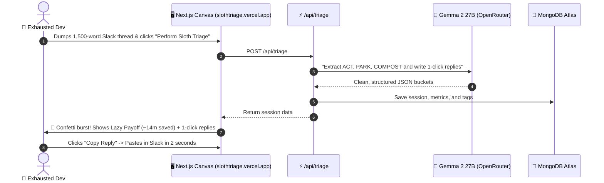

*This is a submission for the [Hacktoberfest Open-Source AI Challenge Week 3: Slow and Steady](https://dev.to/challenges/hacktoberfest-week3-2026-10-19)*

---

## 🛑 The Monday Morning Tragedy: 50 Pings and 0 Will to Live

Picture this:

It’s Monday morning. You just brewed a glorious cup of fresh coffee. You open your laptop ready to build the future... and **BAM**:

- 🔴 **47 unread Slack messages** across 6 channels.
- ✉️ **19 email threads** with titles like *"Quick sync???"* (it is never quick).
- 🤖 **12 bot notifications** letting you know a staging deploy passed at 3:14 AM.
- 🌮 **A 20-message debate** in `#general` about whether pineapple belongs on tacos.

```
   ┌────────────────────────────────────────────────────────┐
   │             THE DEVELOPER DREAD LOOP                   │
   │                                                        │
   │   [ 80 Unread Messages ] ──► [ Open Slack in Panic ]   │
   │            ▲                            │              │
   │            │                            ▼              │
   │     (Pretend to be AFK)        [ Read 2,000 Words      │
   │            ▲                     of Pure Noise ]       │
   │            │                            │              │
   │   [ Die a Little Inside ] ◄── [ Spend 45 Mins Typing   │
   │                                 "Sounds good, thanks!" ]│
   └────────────────────────────────────────────────────────┘
```

Reading 2,000 words of chatter isn't the painful part.  
**The Drafting Tax is.** Formulating polite, professional replies when your soul has already left your body is what destroys your morning.

So in honor of **International Sloth Day** and Hacktoberfest's **"Slow and Steady"** challenge, I took inspiration from nature's ultimate energy conservation expert: **The Sloth 🦥**.

Sloths don't sprint to answer every ping in the jungle. They hang from trees, sleep 18 hours, and only move when it actually matters.

Meet **SlothTriage** — the zero-effort async cognitive buffer for exhausted developers.

---

## 🦥 What I Built

Drop any chaotic wall of text—Slack threads, email digests, Discord chats, or issue notes—into SlothTriage. In 5 seconds, **Google Gemma 2** filters it into **3 clean buckets** and calculates your **"Lazy Payoff"**:

```
                       [ Chaotic Text Dump ]
                                 │
                                 ▼
                     [ 🧠 Google Gemma 2 27B ]
                                 │
         ┌───────────────────────┼───────────────────────┐
         ▼                       ▼                       ▼
 🔴 [ ACT BUCKET ]       🟡 [ PARK BUCKET ]     🟢 [ COMPOST BUCKET ]
 Real decisions only     FYI reading only       Zero-value banter
 + 1-Click Copy replies! + Saved in MongoDB     Pruned from existence!
```

1. **🔴 ACT (High Priority):** Items that actually require a human brain. Gemma pre-drafts polite, context-aware responses—just click **"Copy Reply"** and paste it straight back to your boss.
2. **🟡 PARK (Informational):** Low-urgency updates (AWS S3 price changes, database maintenance). Summarized in one sentence with tags (`#aws`, `#billing`) and saved to **MongoDB Atlas**.
3. **🟢 COMPOST (Pure Noise):** Lunch polls, taco debates, bot spam, and coffee invites. Pruned into digital fertilizer with an audit reason so you know *why* it was ignored.
4. **⚡ The "Lazy Payoff" Metric:** Tells you exactly how much life you just saved:
   - **Words Avoided:** How much fluff you didn't have to read.
   - **Minutes Reclaimed:** Reading time saved + 3 minutes saved per pre-drafted reply.

---

## 🚀 Demo & Links

- **🌐 Live App:** [https://slothtriage.vercel.app/](https://slothtriage.vercel.app/)
- **💻 GitHub Repo:** [https://github.com/Ankit-Kum-ar/slothtriage](https://github.com/Ankit-Kum-ar/slothtriage)



---

## 🧠 How It Works Under The Hood



### 1. Google Gemma 2 27B (`google/gemma-2-27b-it`)
Gemma 2’s open weights are ridiculously good at distinguishing critical blockers (*"Staging webhook key is broken"*) from harmless chatter (*"Who wants boba at 2 PM?"*). We built an automatic fallback to `gemma-2-9b-it` and `gemma-3-12b-it` so your triage never fails even if rate limits hit.

### 2. MongoDB Atlas Document Store
Every triage session is indexed in MongoDB Atlas (`slothtriage.sessions`). You get a searchable **Archive** (`/archive`) to find parked links later and an **Analytics Dashboard** (`/analytics`) showing your cumulative hours reclaimed.

### 3. Next.js 16 + Tailwind v4 + shadcn/ui
Features a persistent **Light/Dark theme toggle**, interactive **Recharts**, and a **mobile Sheet drawer** for when you need to triage emergencies from your phone while lying in bed like a true sloth.

---

## 🌍 Why Open Source AI Matters Here

1. **🔒 Your Slack Secrets Stay Yours:** You shouldn't feed company incident logs, API secrets, or confidential client chats into closed corporate models that train on your data. Gemma's open weights mean you can run this privately.
2. **💸 Micro-SaaS Economics:** Closed models charge high token fees for 3,000-word chat dumps. Open-weight Gemma costs fractions of a cent, making a $5/month developer tool sustainable.
3. **⚡ Zero Hallucination Fluff:** Gemma sticks strictly to our JSON schema without apologizing or adding weird conversational filler.

---

## 💬 Real User Feedback

> *"I ran SlothTriage on a 75-message Slack thread after a 4-day weekend. It found the 2 actual action items, drafted my replies, and composted 18 memes. I replied to my team in 30 seconds and went back to my coffee. 10/10."*  
> — **Senior Backend Dev**

---

## 🎯 The Sloth Manifesto 🦥

Speed is not the same as velocity. Typing *"Thanks, looking into it!"* to 40 people doesn't make you productive; it just makes you tired.

**Stop drowning in red notification badges. Drop your backlog into SlothTriage, take a deep breath, and move slow and steady! 🦥**
